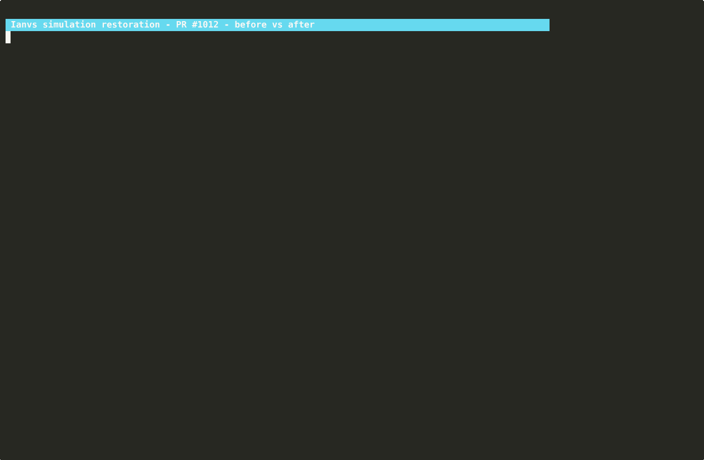
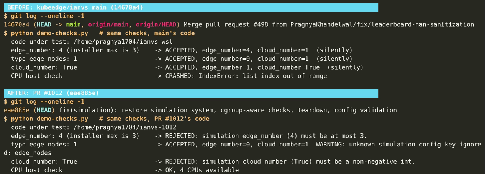
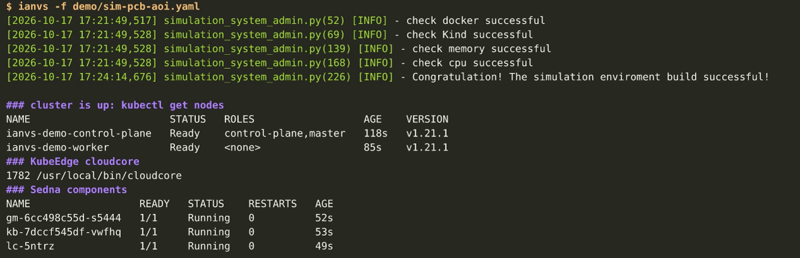
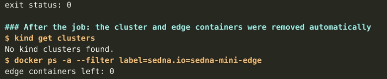
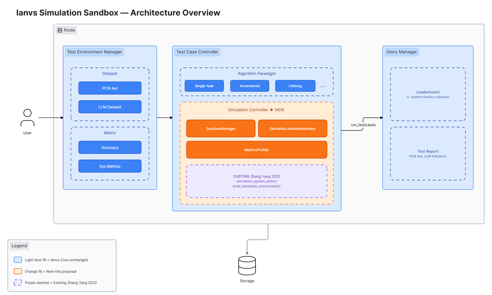
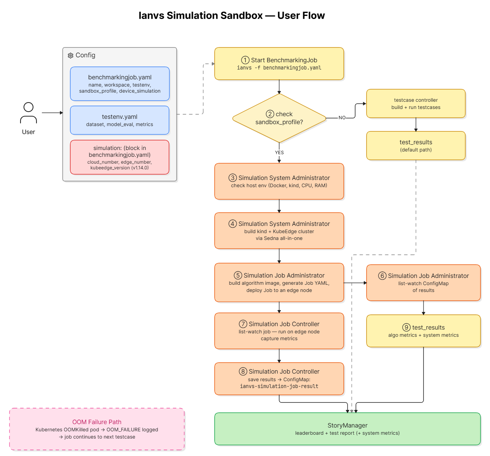

This post shares how I restored the simulation layer of KubeEdge-Ianvs during my CNCF LFX mentorship. Ianvs can once again build a simulated edge-cloud cluster with kind, KubeEdge and Sedna on a single Linux host, run an AI benchmark with it, and remove the cluster when the job ends. It also explains what the simulator does not do yet, and where it is heading.

<!--truncate-->

## The result first

Here is the whole run in under a minute: the same checks on the old code and on the restored code, then a full benchmark with the simulated cluster.



**Before and after.** The same simulation settings, checked by the old code (top) and by the restored code (bottom). The old code accepted settings the cluster installer cannot handle, ignored typos without a word, and crashed while counting CPU cores on a current Linux system.



**The cluster is up.** Ianvs checks the host and builds the cluster, and the KubeEdge cloud side and the Sedna components are running.



**Benchmark results.** The PCB-AoI defect detection benchmark ran with two hyperparameter settings while the simulated cluster was up:

| Rank | Algorithm | F1 score | Paradigm | Momentum | Learning rate |
| --- | --- | --- | --- | --- | --- |
| 1 | FPN | 0.8755 | single-task learning | 0.95 | 0.1 |
| 2 | FPN | 0.8221 | single-task learning | 0.5 | 0.1 |

**Clean teardown.** When the job ended, the cluster and all its containers were removed automatically.



## Why a simulator matters for edge-cloud AI

Ianvs benchmarks AI algorithms for edge-cloud collaboration. It already reports how well an algorithm performs, for example its F1 score or latency. For edge AI that is only half of the picture:

- **Accuracy alone does not tell you whether a model fits on an edge device.** An edge node has limited memory, a few CPU cores and a slow or unreliable link to the cloud.
- **Real edge clusters are hard to get.** Most contributors do not have a fleet of edge devices. A cluster that runs on one laptop lets anyone try an edge-cloud setup.
- **Benchmarks need a fault boundary.** Today every Ianvs test case runs in one process, so one model that runs out of memory stops the whole benchmarking job.

Ianvs was designed with a simulation layer for exactly this, built during OSPP 2022 on top of Sedna's all-in-one installer. Four years of changes in Ianvs, KubeEdge and Sedna had broken it, so my first job was to bring it back.

## Test environment

### Hardware

- Laptop with an Intel Core i3-1115G4 (4 logical cores) and 16 GB of RAM
- 4 cores and about 7 GB of RAM available to the Linux environment

### Operating system

- Windows 10 with WSL 2
- Ubuntu 24.04.3 LTS inside WSL 2

### Software versions

| Component | Version |
| --- | --- |
| Docker | 28.3.3 |
| kind | v0.32.0 |
| KubeEdge | v1.14.0 |
| Sedna | v0.7.0 |
| Kubernetes (from Sedna's installer image) | v1.21.1 |
| Python (Ianvs environment) | 3.7.16 |
| TensorFlow (PCB-AoI example) | 1.15.5 |
| Ianvs | restoration pull request [kubeedge/ianvs#1012](https://github.com/kubeedge/ianvs/pull/1012) |

## How the simulation works

You turn the simulator on by adding a `simulation:` block to your benchmarking job file. When Ianvs sees it, it:

1. checks the host: Docker, kind, at least 4 GB of available memory and at least 4 CPU cores;
2. builds a local cluster with Sedna's all-in-one installer, using kind for the Kubernetes nodes and KubeEdge for the edge side;
3. runs the benchmark;
4. removes the cluster when the job ends, also when the job fails.



The figure shows the full design from the Ianvs Simulation Sandbox proposal. The parts in orange, such as running each test case as a job on a simulated edge node and measuring its CPU and memory use, are the next stage of this work and are not built yet.



## What was restored, and how

These were the main problems I found, and how I fixed them:

| Problem | Fix |
| --- | --- |
| The CPU check parsed `lscpu` output and crashed on current Linux systems, so the simulator could not even start | Count the CPU cores the process may use, and inside a container also respect its CPU limit |
| The memory check read `MemFree` and ignored container limits | Read `MemAvailable`, and inside a container also respect its memory limit |
| The Docker and kind checks could never reach their install fallback, and the fallback piped a downloaded script into `bash` | Check that Docker and kind are installed and working, and otherwise stop with a clear message and an installation link |
| Commands ran through a shell, with values from the config pasted into the command line | Download the installer with `curl -fsSL`, which fails on HTTP errors, and run it without a shell, passing settings as environment variables |
| The installer URL pointed to a `master` branch that no longer exists | Use the `main` branch |
| KubeEdge v1.16 and later fail to install: the installer image's own `keadm` asks for a device CRD file that newer releases no longer ship | Pin the default to KubeEdge v1.14.0, the newest version that installs end to end with this installer |
| `sedna_version: "latest"` was passed through literally and became the image tag `vlatest`, which does not exist, so Sedna never started | Pin the default to Sedna v0.7.0, the newest release, and let the installer pick the newest release when you ask for `latest` |
| Invalid settings were accepted or silently ignored, for example `edge_nodes: 5` instead of `edge_number: 5` | Validate the settings: node counts must be whole numbers within the installer's limits (0 to 2 cloud workers, 0 to 3 edge nodes), empty names are rejected, and unknown keys produce a warning |
| A failed cluster build left a half-built cluster behind | Remove the partial cluster before reporting the error |
| The cluster was never removed after a job | Always remove it when the job ends |
| One failing test case stopped the whole job and threw away the results that had already finished | Report the failure and keep ranking the test cases that completed |

The most surprising one for me was the `latest` bug. The installer only looks up the newest Sedna release when the version is left empty. Passing the word `latest` made it ask Docker Hub for an image called `vlatest`, and every Sedna component got stuck pulling an image that does not exist. I only found it by running the whole build live and reading the pod events. Unit tests alone would not have caught it.

## Try it yourself

The full steps are in the Ianvs guide [How to build simulation env](https://github.com/kubeedge/ianvs/blob/main/docs/guides/how-to-build-simulation-env.md). In short:

### Step 1: Install Ianvs and the prerequisites

Follow the [Ianvs installation guide](https://github.com/kubeedge/ianvs/blob/main/docs/guides/how-to-install-ianvs.md). The simulator also needs a Linux host with Docker and kind installed, at least 4 CPU cores and at least 4 GB of available memory. I used Ubuntu 24.04 on WSL 2.

### Step 2: Add the simulation block

Add a `simulation:` block to your `benchmarkingjob.yaml`:

```yaml
benchmarkingjob:
  ...
  simulation:
    cloud_number: 1
    edge_number: 0
    cluster_name: "ianvs-simulation"
    kubeedge_version: "v1.14.0"
    sedna_version: "v0.7.0"
```

### Step 3: Run the benchmark

```bash
ianvs -f ./examples/pcb-aoi/singletask_learning_bench/fault_detection/benchmarkingjob.yaml
```

Ianvs checks the host, builds the cluster, runs the benchmark, prints the leaderboard and removes the cluster.

## What this tells us

1. **The simulator works again end to end.** On a single laptop, the cluster was ready about two and a half minutes after the host checks, the benchmark completed, and the cluster was removed without leftovers.
2. **Live runs find problems that unit tests miss.** The `latest` bug only appeared when the real installer pulled real images.
3. **The installer sets the version limits.** KubeEdge v1.14.0, Sedna v0.7.0 and Kubernetes 1.21 are the newest combination that works with Sedna's all-in-one installer image.

## Current limitations and next steps

The simulator now builds and removes a cluster reliably, but it is not yet a full sandbox:

- **Edge nodes.** With `edge_number` set to 1 or more, the build currently stops at its last step. Sedna's installer waits only 30 seconds for its pods, and the Sedna pod on a new edge node needs longer because it downloads its image first. The demo above therefore uses cloud nodes only. Together with my mentors, we decided to fix this in Sedna's installer, and I opened [kubeedge/sedna#494](https://github.com/kubeedge/sedna/pull/494): with it, a cluster with an edge node builds successfully, with the Sedna components running on the edge node too.
- **Versions.** Newer Kubernetes and KubeEdge versions need a newer installer image than the one Sedna ships today.
- **One simulation per host.** The installer limits a cluster to 2 cloud workers and 3 edge nodes, and only one simulation can run on a host at a time.
- **Test cases still run in the Ianvs process.** Running each test case as a job on a simulated edge node is the next milestone of the Ianvs Simulation Sandbox proposal.
- **System metrics.** Measuring CPU, memory, GPU, storage and network use for every paradigm is designed in the [proposal](https://github.com/kubeedge/ianvs/blob/main/docs/proposals/simulation/sandbox-engine/sandbox-engine.md) and will be built on top of that milestone.

## Conclusion

Restoring the simulator meant working through four-year-old code, three upstream projects that had moved on, and a lot of logs. The result is a simulator that builds a KubeEdge cluster on one laptop, runs a real benchmark with it, and cleans up after itself. That is the foundation the Ianvs Simulation Sandbox needs.

This work is part of the KubeEdge-Ianvs distributed synergy AI benchmarking initiative and my CNCF LFX mentorship with KubeEdge SIG AI. Thank you to my mentors, Zimu ([@MooreZheng](https://github.com/MooreZheng)) and Dr. Shijing ([@hsj576](https://github.com/hsj576)), for their guidance and reviews.
